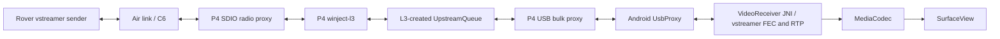

# Implementation guide

## Purpose and system boundary

The app receives rover video through a P4 ground radio attached over USB. The
P4 owns C6/SDIO access and winject-l3. Android owns video stream reconstruction,
playback, and eventually MSP UI/processing.

Channel 0 carries unchanged vstreamer wire datagrams toward Android and link
reports toward the rover. USB channels 1 and 2 are assigned to MSP DisplayPort
and MSP RC telemetry respectively, but are not implemented or registered.

Android does not run winject-l3, create MPDUs, control SDIO registers, or treat
the P4 as a USB network adapter. The P4 does not unwrap video's vstreamer FEC
or RTP. Manager-level FEC is disabled for video, so there is one vstreamer FEC
layer end to end through the radio and USB queues.

## Source map

Paths in this table are relative to the repository root.

| File | Responsibility |
| --- | --- |
| [MainActivity.java](../app/src/main/java/com/flyingcomputer/roverground/MainActivity.java) | USB discovery/permission broadcasts, Surface lifecycle, connect UI and resource teardown |
| [UsbProxy.java](../app/src/main/java/com/flyingcomputer/roverground/UsbProxy.java) | Handler registry, USB ownership, session negotiation, per-channel queues/credits, management correlation, reader/writer threads |
| [Wire.java](../app/src/main/java/com/flyingcomputer/roverground/Wire.java) | Explicit little-endian RGP4 v2 codec and incremental bounded parser |
| [VideoReceiver.java](../app/src/main/java/com/flyingcomputer/roverground/VideoReceiver.java) | Video handler, native pointer ownership, FEC timer, feedback and MediaCodec input/output |
| [receiver.hpp](../app/src/main/cpp/receiver.hpp) / [receiver.cpp](../app/src/main/cpp/receiver.cpp) | Portable vstreamer receive wrapper and link counters |
| [jni.cpp](../app/src/main/cpp/jni.cpp) | JNI bridge and Annex-B access-unit callback |
| [Native CMake](../app/src/main/cpp/CMakeLists.txt) | Pinned core dependency fetches, portable receiver library, JNI or host-test target |
| [Manifest](../app/src/main/AndroidManifest.xml) / [device filter](../app/src/main/res/xml/device_filter.xml) | USB host requirement, launcher/attach handling, VID/PID match |
| [WireTest.java](../app/src/test/java/com/flyingcomputer/roverground/WireTest.java) | JVM wire-format regression tests |
| [receiver_test.cpp](../native-tests/receiver_test.cpp) | Native FEC/RTP recovery and feedback regression |
| [CI workflow](../.github/workflows/build.yml) | JVM tests, APK build, native host tests and APK artifact |

## Connect lifecycle

1. Android creates the Activity and SurfaceView. The Surface must exist before
   connection starts. Work is serialized on `MainActivity.setup`.
2. `discover()` scans for VID/PID 303a:4001. It requests Android USB permission
   if needed, using an app-scoped PendingIntent.
3. `connect()` first disposes of any previous proxy and video receiver, then
   creates a fresh `VideoReceiver` for the current Surface.
4. A fresh `UsbProxy` registers handler 0, claims USB interface 0 and locates
   OUT 01 / IN 81. It sends RESET_SESSION, reads a nonzero session ID and starts
   its reader/writer.
5. HELLO negotiates v2. LIST pages discover available P4 registrations. Every
   locally registered handler must have a remote registration; otherwise the
   current implementation fails the connection.
6. `Channel.open(8)` requests eight P4-to-Android receive slots. The reply
   supplies the opposite window and effective MTU.
7. The reader applies the successful OPEN reply before completing its future
   or parsing following DATA, and queues `onOpen()` before packet callbacks.
8. Detach, protocol failure, failed writes, Surface loss or Activity destruction
   closes the connection. Reconnection constructs fresh objects and resets the
   P4 session; it does not reuse a closed proxy or replay old datagrams.

`UsbProxy` is single-use. `close()` shuts down its handler executors and sets
an atomic closed flag. Registration/connect after close is not a supported
reconnect path, even though every public method does not explicitly reject it.

## Thread and ownership model

| Execution context | Work | Synchronization / ownership |
| --- | --- | --- |
| Android UI thread | Surface callbacks, broadcasts and text updates | Schedules setup/cleanup; does not perform bulk transfers |
| Activity setup executor | Connection, negotiation, opening and teardown | Serializes Activity-owned `proxy`/`video` resources |
| `usb-reader` | Blocking IN reads, parser, management replies and demultiplexing | Single reader; does not run application packet handlers |
| `usb-writer` | Management/credit priority and round-robin DATA writes | Single writer; finishes one complete record before another |
| One handler executor per channel | Ordered `onOpen`, `onPacket`, `onClose` callbacks | One thread, queue capacity 16 |
| Video scheduled executor | Native deadline tick every 20 ms; feedback every fifth tick | Synchronizes on `VideoReceiver` with packet feed/destruction |
| `video-display` | MediaCodec output dequeue and Surface rendering | Running flag controls exit; output thread is joined during receiver close |

`UsbProxy.state` protects channel state, credit counters and scheduling decisions.
Outgoing channel queues and management/request containers also use bounded or
concurrent collections. The reader's parser is confined to its own thread after
initial reset.

A `Lease` owns a received byte array and one receive slot. `Lease.close()` is
idempotent and returns that credit while the session/channel is active. If a
handler processes synchronously, release in `finally`. If it passes the packet
to another consumer, transfer the lease and release it there. Copying bytes into
an unbounded queue and immediately releasing the lease defeats memory bounds.

`VideoReceiver.onPacket()` synchronizes native access and releases its lease in
`finally`. `onClose()` clears its channel reference; it does not free the decoder
or native object. The Activity must separately call `VideoReceiver.close()`.

## Video path

1. The USB parser yields one channel-0 DATA payload containing one vstreamer wire
   datagram. This is not a raw Annex-B frame or an RTP packet yet.
2. `Receiver::ingest()` enforces the 1445-byte input cap, parses the vstreamer
   stream header and rejects non-media/empty/malformed inputs.
3. It counts wire datagrams/bytes and forward sequence gaps. For FEC records it
   passes the shard to `vstreamer::rs_block_erasure`; for raw mode it passes the
   enclosed payload onward directly.
4. Recovered SDUs are RTP datagrams. `rtp_h264_depacketizer` reconstructs Annex-B
   H.264 access units, including fragmented NAL units.
5. Completed AUs call the Java `onAccessUnit(byte[], long, boolean)` method.
6. The Java side waits for an initial keyframe. It submits the AU to MediaCodec
   when an input buffer is available; decoder output is rendered onto a Surface.

The library integrates selected vstreamer core files rather than building its
Linux/SDL application or full `stream_receiver` component. Do not add an Android
UDP loopback bridge just to feed the existing desktop receiver component.

Current decode assumptions and behavior:

- H.264 `video/avc`, configured initially as 1920x1080.
- Nominal 30 fps; native AU PTS conversion uses that rate.
- Maximum codec input buffer request is 4 MiB.
- API 30+ requests MediaCodec low-latency mode.
- `createDecoderByType()` selects the platform default; hardware acceleration
  is not explicitly selected or verified.
- Input dequeue waits up to 10 ms. If no buffer is available or an AU does not
  fit, the receiver waits for another keyframe before resuming input.
- Java clamps PTS to increase monotonically. Frame-rate changes, RTP timestamp
  wrap and stream restart timing need targeted validation.
- Output codec errors are currently logged; they are not consistently propagated
  to the Activity or followed by automatic decoder recovery.

## FEC deadlines and feedback

The 20 ms timer calls `Receiver::tick()` even during input silence, allowing
FEC receive deadlines to release packets without waiting for another datagram.
Every 100 ms it also requests a link report. No report is sent before the first
valid stream-media datagram. After media has started, reports may continue
through a period of silence, matching the receiver's persistent session state.

The report is a vstreamer non-media stream record (4-byte stream header plus a
64-byte link-report payload). It is enqueued on channel 0 with `trySend()` and
travels through P4/L3 to the rover's video upstream. These reports use their own
receiver session/sequence; those values are independent of USB session IDs and
USB record sequence counters.

Historical counter names contain `udp`, but here they count vstreamer datagrams
delivered through USB. Their gaps can include radio loss and proxy queue loss;
they do not isolate the cause. L3/P4 counters are needed to distinguish layers.
`trySend()` failure can drop a feedback report; the current app does not retry
or expose a separate feedback-drop UI counter.

## JNI lifetime contract

Java owns a native pointer returned by `nativeCreate(int session)` and releases
it once through `nativeDestroy(long)`. Feed, tick and destruction are serialized
by the Java monitor. Native receiver/FEC/depay objects are not independently
thread-safe and must not be called concurrently.

| Java native entry | Role |
| --- | --- |
| `nativeCreate(int)` | Allocate state and locate `onAccessUnit` callback |
| `nativeFeed(long, byte[])` | Copy the datagram and run stream/FEC/RTP receive work |
| `nativeTick(long, boolean)` | Expire FEC state, deliver AUs, optionally return feedback |
| `nativeDestroy(long)` | Destroy receiver state after feed/tick are quiescent |

Native callbacks run synchronously inside feed/tick. The stored `JNIEnv*` and
owner object are valid only for that JNI call; they are not global references
for another native thread. The callback signature is `([BJZ)V`. Changes to Java
method names/signatures or to minification require matching JNI/keep-rule work.

C++ exceptions become Java `IllegalStateException`. Audit pending Java exceptions,
method lookup/allocation failure and partial construction when improving this
bridge. Host core tests do not execute JNI or MediaCodec.

## Extending application channels

Android uses `registerHandler(int id, Handler handler)` before connect. IDs are
validated as 0..65535; a Kotlin caller can use `someUShort.toInt()`. The returned
Channel provides `open(window)` and bounded `trySend(payload)`. Exactly one local
handler owns an ID; the registry limit is 16. The P4 must register the matching
L3-created transport before Android connects.

Do not register MSP placeholders in the current app: discovery rejects a local
handler absent from the P4. Before implementing MSP, specify payload boundaries,
versions, MTU, role/direction, remote L3 routing and application acknowledgement
semantics. These are still TBA; the USB channel number alone defines none of them.
